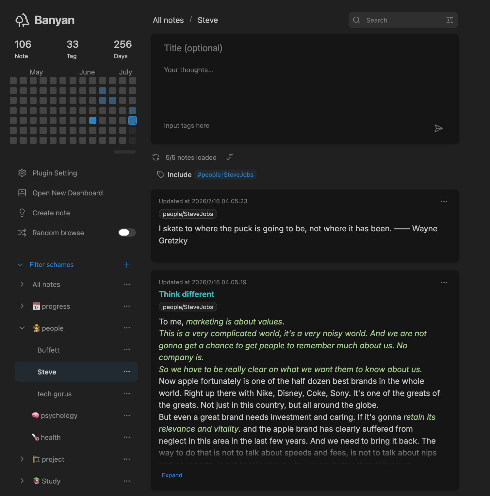

# 🌲 Banyan - Your Obsidian Homepage to Better Organize, Browse, and Review Notes

English | [简体中文](./docs/README_zh.md)

Banyan offers a new way to organize and view your notes:  
- **More Intuitive Note Browsing**: Compared to viewing just note titles, the card view lets you browse notes more intuitively;  
- **Organize Notes with Tags**: Traditional tree structures only allow a single classification method. Organizing notes with tags allows you to organize notes in multiple ways.

## ⚡ Quick Start

### Creating Notes  

You can create notes in specific locations as usual, and they will appear in the card panel.  
However, if you don't care about the location of your notes, you can use the plugin's note creation feature, which creates notes with default locations and titles.  
The highlight of this plugin is organizing notes using tags. Tags in both the note body and properties are displayed in the card view and participate in search.

### Searching Notes & Filter Schemes  

In addition to basic keyword search, date range and tag searches are also supported. Flexible tag search schemes can be combined using "OR, AND, NOT" logic.  
Frequently used searches can be added to "Saved Filters".

### Random Browsing  

You can randomly browse all notes or notes within a specific filter scheme to unexpectedly encounter your past notes.

> For more details, please check:  
> [User Guide](./docs/welcome_en.md)  
> [Changelog](./docs/changelog_en.md)

## 🤖 Installation

### Method 1: Install from Obsidian Community Plugins (Recommended)
1. Open Obsidian settings
2. Go to "Community plugins"
3. Turn off "Restricted mode"
4. Click "Browse", search for "Banyan"
5. Install and enable

### Method 2: Manual Installation
1. Download the release package from `releases`
2. Extract to `.obsidian/plugins/` directory
3. Enable the plugin in Obsidian settings

## ☎️ Questions?

Feel free to ask questions or submit suggestions on GitHub!  
Github issue: [obsidian-banyan - ratiger | Github](https://github.com/ratiger/obsidian-banyan)

Or contact me via:
- Email: 2084939306@qq.com
- RedNote: ratiger (RedNote ID: 1392996322)

## ❤️ Support Me

- 🇨🇳 [ratiger - Afadian](https://afdian.com/a/ratiger) 
- 🌍 [ratiger - Ko-fi](https://ko-fi.com/ratiger) 

## License

GPLv3 - See [LICENSE](LICENSE) file for details